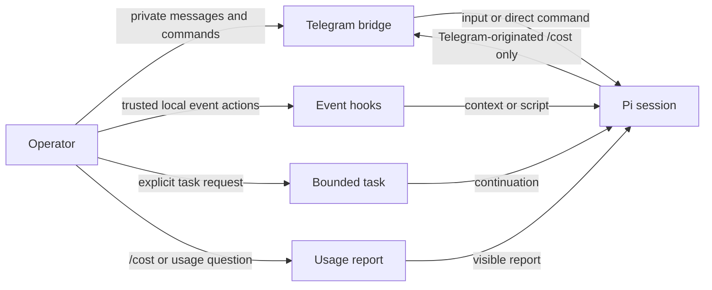

# Pi plugins

A Telegram bridge, usage reports, event hooks, and bounded task continuation for one Pi session.

## Install

Configure GitHub access to install this private package:

```sh
pi install git:github.com/aadegtyarev/pi-plugins
```

If a standalone copy or symlink of an extension is already loaded, resolve it before installing; do not remove an unknown path. Review the source before enabling extensions: they run with the Pi process's permissions. Telegram additionally requires a bot token and explicit startup opt-in.

## Choose an extension

| Extension | Start here |
|---|---|
| `pi-ad-telegram` | [Connect a private Telegram bot](pi-ad-telegram/README.md); then see [commands](pi-ad-telegram/commands.md), [settings](pi-ad-telegram/configuration.md), and [delivery](pi-ad-telegram/operations.md). |
| `pi-ad-session-usage` | Request a deterministic [`/cost`](pi-ad-session-usage/README.md) report or ask for `session_usage_report`. |
| `pi-ad-hooks` | [Add advisory request context or trusted event scripts](pi-ad-hooks/README.md); see the [configuration reference](pi-ad-hooks/reference.md). |
| `pi-ad-task` | [Start and manage one bounded task](pi-ad-task/README.md); the [task-workflow skill](pi-ad-task/skills/task-workflow/SKILL.md) guides the assistant. |

## One session, separate responsibilities



Ordinary Telegram input enters Pi; hooks add context or run local scripts, and tasks continue only by operator approval. Usage reports are on demand; Telegram forwards only a `/cost` requested in that chat.

## Development

From the repository root, run `npm install`, then `npm test`, `npm run typecheck`, and `npm run docs:check`. See [AGENTS.md](AGENTS.md) for contributor workflow and [`docs/contracts/surfaces/`](docs/contracts/surfaces/) for behavior and limits.
