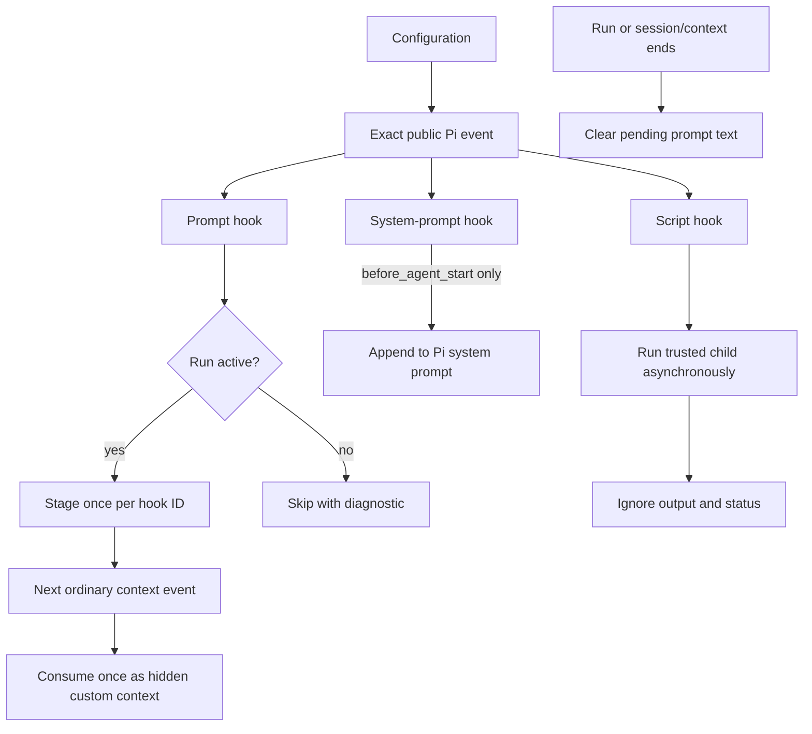

# Hooks reference

`pi-ad-hooks` reads `<agent-dir>/pi-ad-hooks.json` when the extension loads. A missing file means no hooks; changes take effect after reload or session restart. The version-1 shape is:

```json
{
  "version": 1,
  "hooks": {
    "before_agent_start": [
      { "id": "language", "type": "system_prompt", "text": "Reply in English." }
    ],
    "turn_end": [
      { "id": "audit", "type": "script", "script": "audit.mjs", "timeoutMs": 5000 }
    ]
  }
}
```

IDs are unique across the file and match `[A-Za-z0-9_-]{1,64}`. Hook arrays run in order. Invalid entries, unknown events, or invalid timeouts are skipped with safe diagnostics.



## Supported events

Only these 41 public event names from Pi 0.99.0 are accepted. Names are literal keys; there are no aliases or automatic support for private/future events.

| Group | Events |
|---|---|
| Project and resources | `project_trust`, `resources_discover` |
| Session | `session_start`, `session_info_changed`, `session_before_switch`, `session_before_fork`, `session_before_compact`, `session_compact`, `session_compact_failed`, `session_shutdown`, `session_before_tree`, `session_tree` |
| MCP | `mcp_servers_change` |
| Context and provider | `context`, `context_with_system`, `cache_warming_decision`, `before_provider_request`, `before_provider_headers`, `after_provider_response`, `provider_stream_event` |
| Agent and turn | `before_agent_start`, `agent_start`, `agent_end`, `agent_before_settle`, `agent_settled`, `turn_start`, `turn_end` |
| UI prompt | `ui_prompt_start`, `ui_prompt_end` |
| Messages and tools | `message_start`, `message_update`, `message_end`, `tool_execution_start`, `tool_execution_update`, `tool_execution_end`, `tool_call`, `tool_result` |
| Input and selection | `model_select`, `thinking_level_select`, `user_bash`, `input` |

For payloads and native event timing, see [Pi's extension event reference](https://github.com/earendil-works/pi/blob/main/packages/coding-agent/docs/extensions.md#events) and [public API declarations](https://github.com/earendil-works/pi/blob/main/packages/coding-agent/src/core/extensions/types.ts).

## Actions

### `system_prompt`

Shape: `{ "id": "...", "type": "system_prompt", "text": "..." }`; valid only on `before_agent_start`. Appends to `systemPromptOptions.appendSystemPrompt` without replacing Pi's prompt. It adds no user-style message or model turn; use it for standing run instructions.

### `prompt`

Shape: `{ "id": "...", "type": "prompt", "text": "..." }`. Stages advisory text for the next ordinary `context` event in an active run, then consumes it once as a hidden, non-persisted custom message. A `context_with_system` hook waits for the next `context`; repeated firings of one ID coalesce. Text clears at settle or session/context replacement. New idle input clears stale text; steering input preserves it. Outside a run it is skipped with `PROMPT_ACTION_OUTSIDE_RUN`. It cannot start another request, revise a response, or override system/developer instructions.

### `script`

Shape: `{ "id": "...", "type": "script", "script": "relative.mjs", "timeoutMs": 5000 }`. Runs a Node `.mjs` file under `<agent-dir>/pi-ad-hooks/`; resolved paths must stay inside that directory, including through symlinks. The default timeout is 5 seconds; allowed values are 100–30,000 ms.

The child receives one JSON document on stdin: `{ "version": 1, "event": "...", "payload": ... }`. It gets no Pi API/context and only `PATH`, `HOME`, `PI_CODING_AGENT_DIR`, plus platform-required process variables. It runs asynchronously in configuration order for its event; separate events may overlap. Stdout, stderr, exit status, and return values are ignored. A timeout kills the process. Best-effort work, especially at `session_shutdown`, may not finish before Pi exits.

## Trust, failures, and migration

Scripts are not sandboxed: they run with the Pi user's OS permissions and may see prompts, paths, or tool arguments in event data. Configure only trusted code. Script payloads and output are not logged. Failures fail open; diagnostics omit raw errors and stacks. `project_trust` always returns Pi's neutral `{ "trusted": "undecided" }`; hooks never grant or deny trust.

For local installations of the earlier development name `pi-hooks`, first inspect paths and preserve existing files. Move old config/scripts without editing them; remove an old extension symlink only after confirming its target, then link `pi-ad-hooks` to this repository. Do not overwrite regular files or directories. The extension was never released under those old paths.
