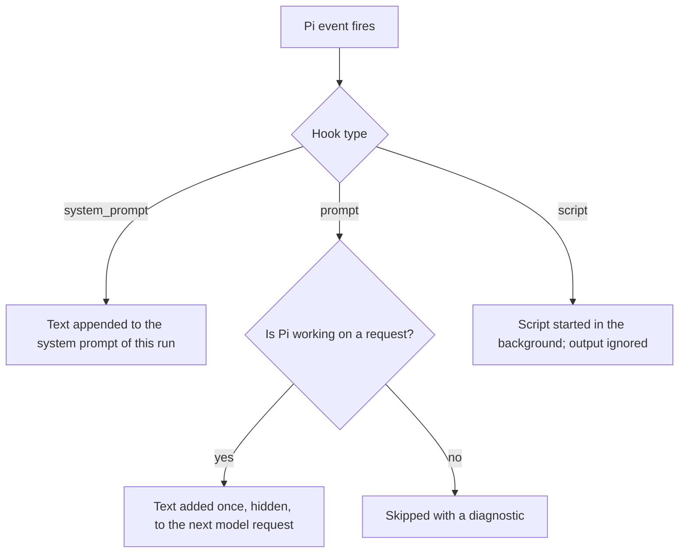

# Hooks reference

## The configuration file

The extension reads `<agent-dir>/pi-ad-hooks.json` (usually `~/.pi/agent/pi-ad-hooks.json`) once, when it loads. After editing the file, run `/reload` or restart Pi. If the file does not exist, there are simply no hooks. Project-local hook files are not supported.

```json
{
  "version": 1,
  "hooks": {
    "before_agent_start": [
      { "id": "language", "type": "system_prompt", "text": "Reply in English." }
    ],
    "turn_end": [
      { "id": "audit", "type": "script", "script": "audit.mjs", "timeoutMs": 5000 }
    ]
  }
}
```

- `hooks` maps an event name to a list of hooks. Hooks for one event run in the order listed.
- Every hook needs an `id`: 1–64 characters from letters, digits, `_` and `-`, unique across the whole file.
- A broken entry (bad ID, unknown event, wrong fields) is skipped and reported; the rest of the file still works.

## The three hook types



### `system_prompt` — add a standing instruction

```json
{ "id": "...", "type": "system_prompt", "text": "..." }
```

Allowed only on `before_agent_start`. The text is appended to Pi's system prompt for that request; Pi's own prompt is kept. Use it for rules that should always apply.

### `prompt` — add a one-time hidden note

```json
{ "id": "...", "type": "prompt", "text": "..." }
```

Works only while Pi is handling a request. The text is attached once, as a hidden message, to the very next model call, and is not saved in the session. If the same hook fires several times before that call, the note is added only once. Leftover notes are discarded when the request ends or the session changes. A note cannot start a new request or override system instructions; the model treats it as advice.

### `script` — run your own code

```json
{ "id": "...", "type": "script", "script": "relative/path.mjs", "timeoutMs": 5000 }
```

- The script must be a `.mjs` file inside `<agent-dir>/pi-ad-hooks/`. Paths that lead outside that folder, including through symlinks, are rejected.
- It is started with Node and receives one JSON document on standard input: `{ "version": 1, "event": "<name>", "payload": { ... } }`.
- Its environment contains only `PATH`, `HOME`, `PI_CODING_AGENT_DIR` and a few variables the OS needs. It has no access to Pi itself.
- Pi does not wait for it. Scripts for the same event run one after another; scripts for different events may run at the same time.
- Output and exit code are ignored. After `timeoutMs` (default 5000, allowed 100–30000) the script is killed.
- Work started at `session_shutdown` may be cut off when Pi exits.

## Supported events

These are the 41 public event names of Pi 1.6.0. Names must match exactly.

| Group | Events |
|---|---|
| Project and resources | `project_trust`, `resources_discover` |
| Session | `session_start`, `session_info_changed`, `session_before_switch`, `session_before_fork`, `session_before_compact`, `session_compact`, `session_compact_failed`, `session_shutdown`, `session_before_tree`, `session_tree` |
| MCP | `mcp_servers_change` |
| Context and provider | `context`, `context_with_system`, `cache_warming_decision`, `before_provider_request`, `before_provider_headers`, `after_provider_response`, `provider_stream_event` |
| Agent and turn | `before_agent_start`, `agent_start`, `agent_end`, `agent_before_settle`, `agent_settled`, `turn_start`, `turn_end` |
| UI prompt | `ui_prompt_start`, `ui_prompt_end` |
| Messages and tools | `message_start`, `message_update`, `message_end`, `tool_execution_start`, `tool_execution_update`, `tool_execution_end`, `tool_call`, `tool_result` |
| Input and selection | `model_select`, `thinking_level_select`, `user_bash`, `input` |

What each event carries and when it fires is described in [Pi's extension docs](https://github.com/earendil-works/pi/blob/main/packages/coding-agent/docs/extensions.md#events).

## Safety and errors

- Scripts are not sandboxed. They run with your user's permissions and may see prompts, file paths and tool arguments. Configure only code you trust.
- Nothing a hook does can stop Pi: every failure is skipped. `project_trust` hooks never decide trust; the extension always answers "undecided".
- Problems are printed to stderr as `[pi-ad-hooks] id=<id> event=<event> code=<CODE>`. Event data, script output and raw errors are never printed.

| Code | Meaning |
|---|---|
| `CONFIG_READ_OR_PARSE_FAILED` | The file exists but cannot be read or is not valid JSON |
| `CONFIG_SCHEMA_INVALID` | `version` is not `1` or `hooks` is missing |
| `UNKNOWN_EVENT` | The event name is not in the list above |
| `HOOK_LIST_INVALID` | The value for an event is not a list |
| `HOOK_ID_INVALID_OR_DUPLICATE` | Bad or repeated `id` |
| `HOOK_ENTRY_INVALID` | Wrong or extra fields for the hook type |
| `SYSTEM_PROMPT_EVENT_INVALID` | `system_prompt` used on an event other than `before_agent_start` |
| `SYSTEM_PROMPT_OPTIONS_MISSING` | Pi did not provide system-prompt options for this run |
| `PROMPT_ACTION_OUTSIDE_RUN` | A `prompt` hook fired while Pi was idle |
| `TIMEOUT_INVALID` | `timeoutMs` is not a whole number between 100 and 30000 |
| `SCRIPT_PATH_INVALID` | Script missing, not `.mjs`, or outside `<agent-dir>/pi-ad-hooks/` |
| `SCRIPT_LAUNCH_FAILED` | The script could not be started |
| `SCRIPT_NONZERO_EXIT` | The script exited with an error code |
| `SCRIPT_TIMEOUT` | The script was killed after `timeoutMs` |
| `EVENT_SERIALIZATION_FAILED` | The event data could not be turned into JSON |
| `SCRIPT_DISPATCH_FAILED` | Unexpected failure while queueing the script |
