# pi-ad-task

Manage one operator-approved task on the active Pi session branch. The extension records progress and continues after successful runs, up to 20 times. Failed or aborted runs pause the task; reloading a session never starts work in the background.

## Start and manage a task

```text
/task <goal>                Start a task
/task status                See its state and progress
/task pause                 Pause future continuation
/task resume [answer]       Resume, optionally answering a blocker
/task done                  Mark complete
/task stop                  Stop and free the task slot
```

`/task start <goal>` is an explicit alternative when a goal begins with a reserved command word. `/cancel` aborts the current Pi operation and pauses an active task; `/task stop` does not cancel an in-flight operation.

The assistant may suggest task mode for substantial work, but must wait for your agreement. `task_control` carries out your explicit start or management request; `task_update` records progress or a blocker. Only one nonterminal task may exist on a branch. Goals and progress are stored in the session transcript and sent to the configured model as ordinary context.

Telegram tasks retain their originating private-chat ID for ownership checks. There are no external notifications or background workers. See the bundled [`task-workflow` skill](skills/task-workflow/SKILL.md) and [task contract](../docs/contracts/surfaces/pi-ad-task.md).

```mermaid
stateDiagram-v2
    [*] --> Active: explicit start
    Active --> Active: successful step; up to 20 continuations
    Active --> Blocked: task_update blocked
    Active --> Paused: failed run, pause, or limit
    Blocked --> Active: resume with answer
    Paused --> Active: resume
    Active --> Done: done
    Active --> Stopped: stop
```


