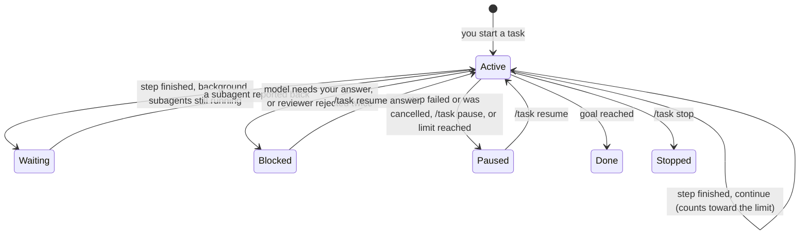

# pi-ad-task

Normally Pi does one piece of work per message and then waits for you. With a task, you give Pi a goal once, and it keeps going on its own: when a step finishes, the extension quietly tells the model "continue toward the goal", and it does. This repeats until the model says the goal is done, asks you a question, or hits the step limit.

## Quick start

```text
/task Fix the failing tests and make sure npm test passes
```

Pi starts working right away. While it works you can:

```text
/task status                See the goal, the latest progress note, and how many steps were used
/task pause                 Stop after the current step
/task resume [answer]       Continue a paused or blocked task; add your answer if Pi asked something
/task limit <N|off|default> Change the step limit for this task (default 40; off = no limit)
/task done                  Mark the goal as reached
/task stop                  Drop the task so you can start a new one
```

If your goal itself starts with one of these words (for example "stop the server from crashing"), write `/task start <goal>`.

You can also just ask in plain words, like "start a task to fix the tests". The model may suggest a task for a large job, but it will not start one until you agree.

## How it works



1. When you start a task, the goal is saved in the session and the model gets a `task_update` tool. It uses that tool to write short progress notes, to say the goal is done, or to say it is blocked and needs you.
2. Every time Pi is about to go idle, the extension checks the task:
   - if the step failed or you cancelled it with `/cancel`, the task is **paused**;
   - if background subagents are still running, the task waits for them (see below);
   - if the step limit is used up, the task is **paused**;
   - otherwise the extension adds a hidden "continue the task; goal: …; progress so far: …" message and Pi does another step.
3. `/task resume` starts the step count again from zero.

Only one task can be open at a time. Finish it, stop it, or mark it done before starting another.

`/task status`, `pause`, `done` and `stop` work even while Pi is busy. They only change what happens *after* the current step; they never interrupt it. To interrupt, use `/cancel`. `/task start` and `/task resume` need Pi to be idle.

## Where the task lives

The task is saved inside the Pi session itself, not in a separate file. That means:

- it survives restarting Pi and reopening the session;
- if you jump to another point with `/tree` or fork the session, you see the task as it was at that point;
- reopening a session never makes Pi start working by itself; an active task waits for the next message or `/task resume`.

The goal and progress notes are part of the conversation, so they are sent to your model like any other message. Nothing is sent anywhere else.

## Working with subagents

This package installs [pi-subagents](https://www.npmjs.com/package/pi-subagents), which lets the model hand work to helper agents: workers, reviewers and others. The task knows about them:

- **Foreground subagents** (the model waits for the result) are simply part of a step. Nothing special happens.
- **Background subagents keep the task waiting, not spinning.** When a step ends while helpers are still running, the task does not push the model to continue and does not use a step from the limit. `/task status` shows "Waiting for N background subagents". When a helper finishes, pi-subagents hands its result to the model, which starts the next step; after that step the task continues as usual. If for some reason no step starts after the last helper finishes, the task starts one itself a couple of seconds later.
- **No "done" while helpers are still working.** If the model tries to mark the task done while background helpers are running, it is told to wait for their results first. You can still end the task yourself with `/task done` or `/task stop` at any time.
- **Review limit.** If the `reviewer` agent rejects the work twice in one task cycle (since the start or the last `/task resume`), the task is **blocked**. The model is told to stop the fix-and-review loop, not to start new helpers, and to report the open findings and your options. Answer with `/task resume <what to do>`. A review counts as a rejection when it ends with `Merge verdict: BLOCK` (what the bundled reviewer writes) or says `REQUEST_CHANGES`. Long reviews are shortened in the chat; the task then reads the full review from the file pi-subagents saved and remembers the verdict in the session, so it still counts after a restart.

If pi-subagents is not running for some reason, the task simply works as if there were no helpers.

## More

- The [`task-workflow` skill](skills/task-workflow/SKILL.md) holds the rules the model follows.
- The [task contract](../docs/contracts/surfaces/pi-ad-task.md) lists exact guarantees and edge cases.
